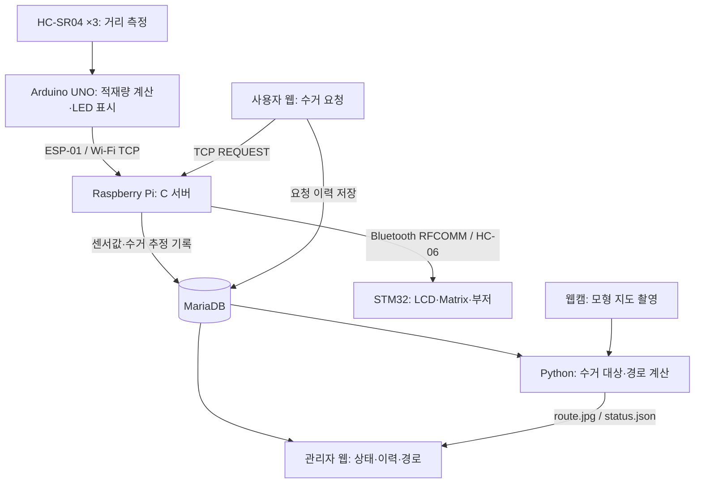

# 음식물쓰레기 관제 시스템

**쓰레기통 3개의 적재량을 원격으로 확인하고, 수거 요청을 현장에 전달하며, 모형 지도 위에 수거 경로를 표시하는 IoT 팀 프로젝트입니다.**

Arduino의 초음파 센서 데이터를 Wi-Fi/TCP로 Raspberry Pi에 전달합니다. 서버는 MariaDB에 데이터를 저장하고, 웹 대시보드와 STM32 관제 장치에 상태를 제공합니다. Python/OpenCV 프로그램은 수거 대상의 방문 순서를 계산하여 웹캠 영상에 경로를 표시합니다.

| 구분 | 구성 |
|---|---|
| 참여 인원 | 2명 — 남기범, 노현주 |
| 측정 노드 | Arduino UNO, HC-SR04 ×3, ESP-01, RGB LED |
| 중앙 서버 | Raspberry Pi 4, C 소켓 서버, MariaDB |
| 웹 | Apache, PHP, HTML/CSS |
| 현장 관제 | STM32 NUCLEO-F411RE, HC-06, LCD1602, 8×8 도트매트릭스, 부저 |
| 경로 시각화 | Python, OpenCV, NumPy, PyMySQL, 웹캠 |
| 주요 통신 | Wi-Fi/TCP, Bluetooth RFCOMM, UART, I2C |

[팀 원본 저장소](https://github.com/WhatTheHJ/waste-bin-monitor) · [상세 핀 연결](pinmap.md) · [경로 설정 예제](route_view/config.example.json)

## 1. 개발 배경과 목표

쓰레기통의 적재량을 현장에서만 확인하면 비어 있는 통에도 방문하거나, 가득 찬 통의 수거가 늦어질 수 있습니다. 이를 개선하기 위해 다음 기능을 연결했습니다.

- **원격 상태 확인:** A/B/C 쓰레기통의 적재량과 갱신 시각을 웹에서 확인
- **수거 요청 전달:** 사용자 웹 요청을 DB에 기록하고 STM32 관제 장치에 알림
- **수거 경로 제안:** 적재량이 기준을 넘은 통을 선택하고 모형 도로의 방문 순서를 비교
- **수거 이력 관리:** 적재량 감소를 기준으로 수거를 추정하여 이력 저장

## 2. 담당 역할

이 저장소는 공동 개발한 팀 프로젝트를 Fork하여 정리한 개인 포트폴리오입니다. 역할은 프로젝트 발표자료의 분담 내용을 기준으로 하며, 아래 시스템 설명은 팀 전체 결과물에 대한 설명입니다.

| 팀원 | 담당 역할 |
|---|---|
| **남기범** | **프로그래밍 총괄, 하드웨어 제작, 배선 일부 담당** |
| 노현주 | 하드웨어 제작 및 배선 담당, 프로그래밍 일부 |

## 3. 시스템 구성과 데이터 흐름



### 센서 데이터 전달

1. 초음파 센서로 쓰레기통 내부의 거리를 측정합니다.
2. Arduino에서 빈 통·가득 찬 통의 기준 거리를 이용해 적재량을 계산합니다.
3. ESP-01을 통해 A/B/C 값을 Raspberry Pi의 TCP 서버로 전송합니다.
4. 서버는 DB 저장에 성공하면 수거 여부를 검사하고 STM32에 상태를 전달합니다.
5. 관리자 웹과 경로 프로그램은 DB의 최신 값을 읽어 화면을 갱신합니다.

### 사용자 수거 요청

1. 사용자가 `request.php`에서 A/B/C 중 하나를 선택합니다.
2. PHP가 요청 이력을 저장하고 로컬 TCP 서버로 `REQUEST` 메시지를 보냅니다.
3. 서버가 HC-06을 통해 STM32에 요청을 전달합니다.
4. STM32가 LCD, 도트매트릭스, 부저로 해당 요청을 알립니다.

## 4. 주요 기능

### 적재량 측정과 상태 표시

Arduino는 빈 통 거리 `EMPTY_DISTANCE`와 만재 거리 `FULL_DISTANCE`를 기준으로 적재량을 계산하고 0~100%로 제한합니다. 현재 기준은 각각 18cm, 3cm이며 실제 모형의 크기에 맞춰 보정해야 합니다.

| 적재량 | Arduino LED | 관리자 웹 상태 |
|---|---|---|
| 0~40% | 초록 | 여유 |
| 41~75% | 노랑 | 주의 |
| 76~90% | 빨강 | 혼잡 |
| 91~100% | 빨강 깜빡임 | 수거 필요 |
| 음수 센서값 | 꺼짐 | 센서 오류 |

관련 코드: [Arduino 스케치](arduino/waste_bin/waste_bin.ino), [관리자 웹](web/index.php)

### STM32 현장 관제

| 출력 장치 | 동작 |
|---|---|
| LCD1602 | A/B/C 적재량 표시, 사용자 요청 시 해당 통을 약 5초간 안내 |
| 8×8 도트매트릭스 | 모형 지도 표시, 75% 초과 위치 깜빡임, 사용자 요청 위치 약 5초간 알림 |
| 부저 | 사용자 요청 시 약 2초 동안 0.5초 울림·0.5초 쉼 반복 |

현재 부저 코드는 **사용자 수거 요청에 반응**하며, 적재량 90% 이상만으로 자동 작동하지 않습니다. 요청 표시 시간이 끝나도 적재량이 75%를 초과하면 매트릭스의 적재량 알림은 계속 적용됩니다.

관련 코드: [main.c](Core/Src/main.c), [dot_map.c](Core/Src/dot_map.c), [buzzer.c](Core/Src/buzzer.c), [LCD 헤더](Core/Inc/lcd1602.h)

현재 저장소에는 LCD 헤더와 호출 코드는 있으나 `LCD_Init()` 등의 구현 소스가 확인되지 않습니다. STM32 빌드를 재현하려면 실습 때 사용한 LCD 구현 파일을 추가로 준비해야 합니다.

### 웹 관제와 수거 기록

- 관리자 화면에서 최신 A/B/C 적재량, 갱신 시각, 최근 수거 이력 10건과 오늘의 수거 건수를 표시합니다.
- 관리자 페이지는 3초 간격으로 새로고침합니다.
- 사용자 화면에서 통별 수거 요청을 등록합니다.
- 서버는 기준 적재량보다 **20%p 이상 낮은 값이 2회 연속 확인**되면 수거로 추정하여 기록합니다.

자동 수거 판정은 센서값 감소에 기반한 추정입니다. 실제 수거 완료를 별도 센서나 작업자 확인으로 검증하는 방식은 아닙니다.

## 5. 웹캠 기반 수거 경로 시각화

[route_view.py](route_view/route_view.py)는 DB의 적재량을 읽어 설정한 지도 좌표에 경로를 표시합니다. 웹캠 영상에서 쓰레기통이나 도로를 자동 인식하는 방식이 아니라, **설정된 8×8 격자·도로·쓰레기통 좌표를 영상에 투영하는 방식**입니다.

### 경로 계산

1. 기본 기준값인 **75%를 초과한 쓰레기통**을 수거 대상으로 선택합니다.
2. 설정의 도로 칸을 따라 BFS로 구간 경로를 찾습니다.
3. 대상 통의 모든 방문 순서에 대해 총 경로 길이를 비교합니다. 통 3개이면 최대 6개 순서를 비교합니다.
4. 계산한 순서와 경로를 웹캠 영상에 표시합니다.
5. `route.jpg`와 `status.json`을 저장하고 PHP 화면에서 읽습니다.

### 설정과 동작 범위

- `bins`: 통별 지도 좌표
- `road`: 이동 가능한 도로 칸(`#`)
- `corners`: 웹캠 영상에서 지정한 지도 네 모서리
- `threshold`: 수거 대상 기준값, 기본 75
- `depot`: 차고지 좌표. 기본값은 `null`이며 지정하면 출발·복귀 구간도 계산
- DB 조회·출력 저장 주기: 기본 각각 2초
- 도로가 없거나 연결 경로를 찾지 못한 구간은 직선으로 연결하는 대체 동작이 있음

경로는 설정된 모형 지도 기준입니다. 현재 수거 대상 선정에는 적재량을 사용하며, 웹의 사용자 요청 이력을 별도 우선순위로 반영하지 않습니다.

## 6. 통신 프로토콜

TCP 포트는 실행 예시에서 `5000`을 사용합니다. 메시지는 `@`로 필드를 구분하고 줄바꿈(`\n`)으로 끝납니다.

| 구간 | 메시지 예 | 의미 |
|---|---|---|
| Arduino → Pi | `SENSOR@78@20@55\n` | A/B/C 적재량 전송 |
| Pi → STM32 | `STATUS@78@20@55\n` | 관제 장치 상태 갱신 |
| 사용자 웹 → Pi → STM32 | `REQUEST@A\n` | A통 수거 요청 |

HC-06과 STM32 사이에는 USART1을 사용합니다. 서버는 `/dev/rfcomm0`으로 Bluetooth 메시지를 전송합니다.

## 7. 데이터베이스

현재 C/PHP/Python 코드가 사용하는 DB는 `iotdb`입니다.

| 테이블 | 코드에서 사용하는 주요 컬럼 | 용도 |
|---|---|---|
| `food_bin` | `id`, `bin_a`, `bin_b`, `bin_c`, `created_at` | 센서값 저장 및 최신 상태 조회 |
| `collection_history` | `id`, `bin_name`, `collected_at` | 자동 수거 추정 기록 |
| `request_history` | `bin_name` | 사용자 요청 기록 |

**저장소에는 DB 생성용 SQL 파일이 포함되어 있지 않습니다.** 실행 전에 기존 실습 DB를 복원하거나 코드의 조회·삽입에 맞는 테이블, 기본값, 계정 권한을 준비해야 합니다. 위 표는 코드에서 확인되는 항목이며 전체 원본 스키마는 아닙니다.

발표자료에는 `bins`, `data_quality_log`와 이상값 검사 트리거도 설명되어 있습니다. 해당 DB 정의와 트리거 배포 파일은 현재 저장소에서 확인되지 않으므로 별도 실습 자료가 필요합니다. 경로 프로그램의 통 좌표는 현재 JSON 설정에서 읽습니다.

## 8. 저장소 구조

| 경로 | 내용 |
|---|---|
| `Core/Inc/`, `Core/Src/` | STM32 초기화, UART 수신, LCD 호출, Matrix·부저 제어 |
| `Drivers/` | STM32 HAL 및 CMSIS |
| `arduino/waste_bin/waste_bin.ino` | 초음파 측정, LED 표시, Wi-Fi 전송 |
| `raspberry/food_server.c` | TCP 수신, DB 저장, 수거 판정, Bluetooth 전달 |
| `web/index.php` | 관리자 관제 화면 |
| `web/request.php` | 사용자 수거 요청 화면 |
| `route_view/route_view.py` | 웹캠·DB 연동 및 경로 계산·출력 |
| `route_view/config.example.json` | 지도·카메라·DB 설정 예제 |
| `waste-bin.ioc` | STM32CubeMX 설정 |
| `.project`, `.cproject` | STM32CubeIDE 프로젝트 설정 |
| `pinmap.md` | 상세 배선 및 핀 연결 |

## 9. 실행 준비와 방법

아래 명령은 Raspberry Pi에서 저장소 루트를 기준으로 실행하는 예시입니다. 실제 보드, 센서, DB와 네트워크 설정이 필요합니다.

### 9-1. Raspberry Pi 의존성

```bash
sudo apt update
sudo apt install build-essential mariadb-server libmariadb-dev apache2 php php-mysql bluez python3-opencv python3-numpy python3-pymysql
```

DB 준비 후 다음 파일의 접속 정보를 실제 환경에 맞춥니다. 코드의 기본 DB 계정은 `iot`, DB 이름은 `iotdb`입니다.

- `raspberry/food_server.c`
- `web/index.php`
- `web/request.php`
- `route_view/config.json` — 아래에서 예제로부터 복사

실제 비밀번호와 로컬 설정 파일은 공개 저장소에 올리지 않습니다.

### 9-2. Bluetooth와 TCP 서버

HC-06의 페어링과 신뢰 설정을 마친 뒤, 실제 MAC 주소로 RFCOMM 장치를 연결합니다.

```bash
sudo rfcomm bind 0 <HC-06-MAC> 1
ls -l /dev/rfcomm0
```

서버 실행 계정이 `/dev/rfcomm0`에 쓸 수 있는지 확인합니다. 재부팅 후에는 바인딩을 다시 해야 할 수 있습니다.

```bash
gcc raspberry/food_server.c -o food_server $(mariadb_config --cflags --libs)
./food_server 5000
```

### 9-3. 웹 배포

```bash
sudo cp web/index.php /var/www/html/index.php
sudo cp web/request.php /var/www/html/request.php
```

- 관리자: `http://<PI_IP>/index.php`
- 사용자: `http://<PI_IP>/request.php`

같은 네트워크의 PC나 휴대폰에서 접속합니다. 이 프로젝트의 웹 화면은 실습용 구성입니다.

### 9-4. 경로 화면

```bash
cp route_view/config.example.json route_view/config.json
```

`config.json`에서 DB 비밀번호, 카메라 번호, 통 좌표, 도로를 맞춥니다. 관리자 PHP를 위처럼 `/var/www/html`에 배치했다면 **`output_dir`도 `/var/www/html/route`로 변경**합니다. 예제의 `/var/www/html/webcam/route`를 그대로 사용하면 PHP가 읽는 위치와 달라집니다.

프로그램 실행 계정에는 경로 출력 디렉터리 쓰기 권한을, Apache에는 읽기 권한을 설정합니다. 예를 들어 현재 사용자가 프로그램을 실행하고 Apache 그룹이 `www-data`인 환경에서는 다음과 같이 준비할 수 있습니다.

```bash
sudo install -d -o "$(id -un)" -g www-data -m 2755 /var/www/html/route
```

모니터가 연결된 그래픽 환경에서 카메라 영상을 보며 지도 모서리를 보정합니다. 카메라나 지도를 옮기면 다시 보정합니다.

```bash
python3 route_view/route_view.py --calibrate
python3 route_view/route_view.py
```

보정 후 창 없이 출력 파일만 갱신하려면:

```bash
python3 route_view/route_view.py --no-window
```

DB와 카메라 없이 경로 UI를 확인하는 데모 모드도 있습니다. 그래픽 환경에서 실행하고 `1`, `2`, `3`으로 A/B/C 값을 변경합니다.

```bash
python3 route_view/route_view.py --demo --camera -1
```

### 9-5. Arduino

Arduino IDE에서 `arduino/waste_bin/waste_bin.ino`를 열고 UNO 보드를 선택합니다.

- 사용 라이브러리: `SoftwareSerial`, `WiFiEsp`, `MsTimer2`
- Wi-Fi SSID·비밀번호, Pi IP, TCP 포트를 실제 환경에 맞춤
- ESP-01 AT 펌웨어와 통신 속도 `38400bps` 확인
- `EMPTY_DISTANCE`, `FULL_DISTANCE`를 통 크기에 맞게 보정
- 센서와 LED는 [pinmap.md](pinmap.md)에 따라 연결

### 9-6. STM32

STM32CubeIDE에서 저장소 루트의 기존 프로젝트를 가져옵니다. `.project`에 기록된 프로젝트 이름은 **`waste-bin`**입니다.

| 항목 | 설정·연결 |
|---|---|
| HC-06 UART | USART1, 9600bps, 8N1, 수신 인터럽트 |
| HC-06 TX → STM32 RX | PA10 / D2 |
| HC-06 RX ← STM32 TX | PA9 / D8 |
| 디버그 UART | USART2, 115200bps |
| LCD I2C | I2C1, SCL PB8 / SDA PB9 |
| Matrix DATA / CLK / LATCH | PA7 / PA6 / PB6 |
| 부저 | PA0 / TIM2_CH1 |

먼저 누락된 LCD 구현 소스를 복원한 뒤 `waste-bin` 프로젝트를 빌드하고 ST-LINK로 다운로드합니다. 현재 ZIP만으로는 LCD 함수의 구현을 확인할 수 없어 완전한 빌드 재현을 보장할 수 없습니다. `waste-bin.ioc`에서 코드를 다시 생성할 경우 UART 속도와 수신 인터럽트 설정을 확인합니다.

## 10. 트러블슈팅 경험

### 도트매트릭스 미점등과 배선 진단

**증상:** 코드를 업로드했지만 도트매트릭스가 켜지지 않았습니다. 74HC595 두 개를 거치는 회로여서 문제 위치를 바로 찾기 어려웠습니다.

**진단:** 발표자료에서는 GPIO 내부 저항을 Pull-up·Pull-down으로 바꿔 두 번 읽는 진단을 사용했습니다. 두 값이 모두 HIGH 또는 모두 LOW이면 해당 상태로, 풀 저항에 따라 값이 달라지면 OPEN 후보로 판단했습니다. 현재 `dot_map.c`에도 `DM_ReadPinState()` 진단 코드가 포함되어 있습니다.

**원인과 조치:** 느슨하게 꽂힌 배선이 OPEN으로 판정되어, 해당 배선을 다시 꽂아 문제를 해결했습니다.

이 방법은 해당 실습 회로에서 부유 입력을 찾는 보조 진단입니다. 저항값이나 접촉 상태를 정밀 측정하거나 모든 단선을 확정하는 검사는 아닙니다.

### 실행 환경 점검

| 증상 | 확인할 항목 |
|---|---|
| TCP 포트 사용 중 | `ss -ltnp`로 5000번 포트를 점유한 기존 서버 확인 |
| `/dev/rfcomm0` 없음 | Bluetooth 페어링·RFCOMM 바인딩 확인 |
| STM32에 요청이 전달되지 않음 | 서버 로그, HC-06 연결, USART1 9600bps 및 RX/TX 배선 확인 |
| 웹 경로 화면이 없음 | `route_view.py` 실행 여부, `output_dir`와 PHP의 `route/` 경로 일치 여부 확인 |
| 경로 파일 저장 실패 | 실행 계정의 출력 폴더 쓰기 권한 확인 |
| DB 접속·쿼리 오류 | DB 계정·비밀번호·권한, 필요한 테이블 및 컬럼 확인 |

## 11. 시연 확인 순서

1. Raspberry Pi에서 DB, 웹, RFCOMM과 TCP 서버를 준비합니다.
2. Arduino와 STM32를 켜고 Wi-Fi 및 Bluetooth 통신을 확인합니다.
3. 센서와 물체 사이 거리를 바꾸어 LED·관리자 웹·LCD의 값 변화를 확인합니다.
4. 75%를 초과하는 통을 만들어 Matrix 알림과 경로 대상 선정을 확인합니다.
5. 사용자 웹에서 수거를 요청하고 LCD·Matrix·부저 알림을 확인합니다.
6. 기준 적재량보다 20%p 이상 낮은 상태가 두 번 들어오도록 하여 수거 이력을 확인합니다.
7. 카메라 영상의 경로와 관리자 웹의 방문 순서 표시를 확인합니다.

## 12. 현재 범위와 확장 방향

- 통 3개와 설정된 모형 도로를 대상으로 경로를 비교합니다.
- 사용자 수거 요청은 현장 알림으로 전달하며, 경로 대상은 현재 적재량으로 선정합니다.
- DB 스키마·트리거 파일과 LCD 함수 구현 소스는 현재 저장소에서 확인되지 않습니다. 전체 실행·빌드 재현을 위해 해당 실습 파일의 보완이 필요합니다.
- 발표자료·시연 영상은 현재 저장소에 포함되어 있지 않습니다.
- 향후 확장 대상으로 다중 차량 배차, 수거 기록 기반 만재 예측, 수거 요청 우선순위 반영을 고려할 수 있습니다.

이 문서는 저장소 코드와 팀 발표자료를 대조해 정리했습니다. 실행 절차는 해당 코드 구성을 기준으로 하며, 다른 환경에서 재현하려면 실제 배선·DB·네트워크 설정을 함께 준비해야 합니다.
